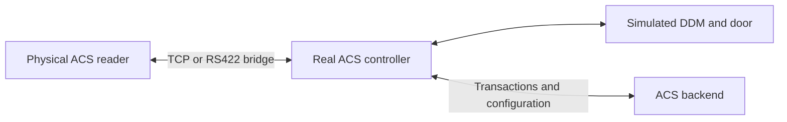

# ACS Simulator

**Test access-control firmware from your browser.**

Open a simulated door, tap a reader, take a cabinet key or inject an input fault.
Watch the real controller respond, repeat a test and collect evidence when
something behaves unexpectedly. The simulator models hardware; the controller
retains access decisions, PIN verification, modes, alarms and backend reporting.

[Download for Windows x64](https://github.com/wernerong/acs-simulator-releases/releases/latest)
| [Release notes](https://github.com/wernerong/acs-simulator-releases/releases)
| [Feature tour](#explore-the-simulator)
| [Quick start](#install-and-start)

This repository distributes installers and signed automatic updates. The source
repository stays private. **No GitHub account or GitHub token is needed.**

## Install and start

You need a Windows x64 PC, Docker Desktop running its Linux/WSL2 engine, and
network access to an authorized ACS test backend. Ask your administrator for
the backend hostname and onboarding API key.

1. Download **ACS-Simulator-Windows-x64-<version>.zip** from the latest release.
2. Extract the whole ZIP to a permanent folder and double-click **Start.cmd**.
3. Create your local simulator login and enter your backend onboarding details.
4. Register this installation's generated controller serial in your backend,
   configure its doors/readers/cabinets, then complete configuration synchronization (DNDS).
5. Open the simulator in your browser and choose a configured device to test.

The package runs the controller, simulator and local database together in Docker.
It does not include your backend, onboarding key, device certificates or live
users/cards. A fresh installation has no configured doors until your backend
configuration is synchronized. Do not reuse another controller's identity.

## Explore the simulator

Screenshots show the actual 5.6.1 interface with synthetic demo data, not a live
installation. Names, cards, keys and incident details are examples. Available
devices and controls depend on your controller configuration and firmware.

### Doors and readers

Choose a configured door, select a database card and tap its IN or OUT reader.
Watch the controller's lock output and reader status, then move the simulated
door contact. Test exit requests, key switches, break glass and wiring faults.


Serial and IP readers support the implemented card/PIN flows, including Normal,
Secure and Supervised access. Door models include EM locks, HSM120/HSM220,
sliding doors, starter doors, 120-degree turnstiles and optical gates.
The controller decides access and relocking; a button press is not an access grant.
Windows 5.7.0 includes enrolled/unrecognised face inputs and a calibrated Baidu
RGB comparison adapter for compatible templates. The controller retains matching
thresholds and access decisions. Unsupported biometric formats and multi-person
IP flows are not simulated. Physical reader networking/source-IP mapping requires
separate validation on Docker hosts.

An optional **Linux ARM64 biometric runtime** is provided as a separate release
download for native simulator deployments. It contains independent face/iris
comparison libraries and deployment notes, without source or vendor SDK files.
It does not enable Windows iris support. Enrollment is excluded from both the
Windows package and this SDK download.

<details>
<summary>See the dashboard and navigation</summary>


</details>

### Pair physical readers with simulated doors

On native Raspberry Pi deployments, a compatible physical ACS reader can replace
a virtual reader while the simulator continues modelling the DDM, door movement,
contacts and lock feedback. Real card taps or supported biometric scans follow
the controller's normal credential verification, access decisions and backend
reporting. Transactions and live logs remain visible beside the simulated door
controls.



The native Pi's **Manage → Physical readers** page selects physical or simulated
operation using the current controller configuration.

| Connection | How pairing works |
| --- | --- |
| IP reader | Connects directly to the controller's configured TCP listener. The reader's source IP identifies its configured IN/OUT role; virtual inputs for that reader are disabled while physical mode is selected. |
| RS422 serial reader | Connects through a USB-to-RS422 converter and the simulator's serial bridge. Physical mode replaces all virtual readers on the selected bus and forwards the actual reader protocol. |

Physical IP-reader face and iris operation has been confirmed on the native Pi
with compatible templates and downloaded enrollments. Serial hardware acceptance
remains pending. Compatible ACS reader firmware, network or serial settings, and
backend reader configuration are required; arbitrary reader protocols are not
translated.

**The Windows Docker package does not currently expose physical-reader setup.**
Docker networking/source-IP mapping and serial transport require separate
validation. The optional ARM64 SDK download supports compatible native
deployments; it does not enable Windows iris support.

### Key cabinets

Choose a cardholder, request an authorized key or group, open the cabinet and
take or return keys. Follow the on-screen visit steps and slot inventory.
Check misplaced keys, exercise wrong-slot returns and observe controller outcomes.

Version 5.8.0 detects the controller's cabinet API before each visit. Newer
firmware uses controller-owned sessions; older branches retain their user/card
API flow. Checkout, returns and two-card keys follow the detected contract.
Expired or mismatched sessions require a new card tap, without silently retrying
through the older API. Changing controller firmware also requires a fresh visit.


### Inputs, alarms and connection faults

Select an LSDI input and switch between normal, event, cut wire and short circuit.
Operate DOR relay outputs. Test mains failure, battery state, supply voltage,
controller tamper and configured DDM fire inputs.


Connections supports timed outages for boards, reader buses, individual serial
or IP readers, and the backend. Restore communications and watch recovery.
Resetting a physical input does **not** clear a controller-latched alarm.
Optional browser sound is a test aid, not a safety siren.

<details>
<summary>See power and controller tamper controls</summary>


</details>

### Repeatable scenario plays

Start from a template, add actions and observations, map lanes to configured
targets, then check and run the play. Save scenarios for repeat testing and inspect
the run timeline. Supported targets include DDM EM/HSM doors, LSDI, controller
tamper and timed connections. Door lanes can run together; connection lanes run
sequentially. Plays continue when the browser closes while the host remains awake.

<details>
<summary>See the scenario builder and a two-door test play</summary>


</details>

### Evidence when something goes wrong

Use **Report an issue** for unexpected behavior, or **Record a test** before
reproducing it. Add the expected and actual result, review the captured steps
and evidence, then download a developer ZIP. Recordings retain the selected door
or cabinet context plus shared input/connection evidence across navigation;
they do not record every other door and cabinet automatically.


No built-in AI, automatic upload or automatic replay. Review reports and original
logs before sharing: device identifiers and your own notes may still be sensitive.

## More tools in the same installation

| Area | What you can do |
| --- | --- |
| Controller monitor | Search transactions and live logs, pause polling, resize the panel, or dock it at the bottom, side or in a separate window. |
| Diagnostics | Inspect grouped failures and service status; download original controller logs as ZIPs. |
| Database explorer | Browse controller tables read-only to verify downloaded configuration and recorded state. |
| Lift panel | Exercise configured lift-reader and floor-selection behavior. |
| Controller settings | Inspect effective settings, edit supported configuration files and restart the controller when required. |
| Controller firmware | Upload a compatible firmware ZIP, switch versions and delete stale library versions with password confirmation. Different managed DLL hashes are allowed; runtime compatibility checks still apply. |
| MCP integration | Discover inspection tools and configured physical controls from an MCP-compatible client. Optional, disabled by default; owner-enabled writes share one dedicated token. |
| Traceability | See the simulator version beside Sign out and the separate installed controller firmware version. |

<details>
<summary>See Diagnostics and original log downloads</summary>


</details>

## Your first test

After onboarding and configuration synchronization:

1. Open **Doors & readers** and choose a configured door and card.
2. Tap the IN reader. Enter a PIN if prompted; let the controller decide access.
3. Move the simulated door contact, then close it and observe the lock and reader.
4. Check **Controller transactions** for the resulting evidence.
5. If the result is unexpected, select **Report an issue**, or record the next attempt.

Use only an authorized test environment. Controls can generate real controller
alarms and backend transactions. An HTTP-accepted transaction is not proof that
the backend displayed it. The simulator is not a production access controller
or safety/alarm system.

## Install once, keep receiving updates

While Docker and ACS Simulator are running, the updater checks for signed stable
releases every five minutes. It waits for active scenario/administration work,
verifies the update, backs up the database and checks health after installation.
Expect a brief service interruption. Failed health checks restore the previous images.

Your local login, onboarding details, controller identity, database, captures,
saved firmware and selected controller version are retained. Simulator updates
and controller firmware selection are separate. Offline or sleeping PCs catch up
when they are running and connected again.

Use **Stop.cmd** to stop without deleting data, and **Diagnose.cmd** to inspect
update status. **Do not uninstall to upgrade**: Uninstall deletes local data after
confirmation. Keep the extracted launcher folder.

## MCP: optional client access

Enable MCP in **Deployment settings**, confirm your simulator login and store
the issued token privately in your client's secret store. Use the client's tool
catalog to discover reads and **list_controls** to discover configured actions.
For physical writes, explicitly enable **Allow physical tests** using the same
token; older read-only configurations do not gain writes automatically.

The local endpoint is **/mcp** with Bearer authentication. A cloud bot cannot reach
localhost without a separately configured secure route. MCP does not add an AI
model to the simulator. It does not expose arbitrary shell/SQL writes or firmware
administration. Factory reset requires prepared, one-use human confirmation.
You remain responsible for test actions and their backend effects.

### Full MCP tool catalog

Public and private **Windows 5.8.0** packages both use MCP server **0.4.0** and
expose these **17 tools**; Windows 5.7.0 already carries the same catalog.
Older installations may show fewer tools until updated. Reconnect/refresh your
client's tool list after updating. All names remain discoverable while writes
are disabled; permission is checked when a tool is called. The same token is
used after owner write opt-in, including for reset preparation.

<!-- mcp-tool-catalog:start -->
| Tool | Access | What it does |
| --- | --- | --- |
| `get_instance_info` | Read | Identify the installation/controller, firmware branch/build, capabilities, limits and current write permission. Call this first. |
| `list_devices` | Read | List configured device IDs, names, kinds and mapped hardware routes; supports kind filtering and pagination. |
| `get_device_state` | Read | Read one device's observed simulator state and controller status codes, including freshness/unavailable indicators. |
| `get_transactions` | Read | Read paginated controller send attempts, readable descriptions, reader direction and HTTP outcomes; acceptance is not proof of backend storage/display. |
| `get_diagnostics` | Read | Read bounded, grouped controller failures and service health with masked evidence and source timestamps. |
| `list_tables` | Read | Discover public-schema database tables, approximate row counts and masked columns. |
| `read_table` | Read | Read masked table rows with paging, search and sorting; no arbitrary SQL, credential values or biometric templates. |
| `list_issue_reports` | Read | List locally saved issue-report summaries for this controller; does not start a recording. |
| `get_issue_report` | Read | Read expected/actual notes and paginated reproduction events; page zero includes bounded related evidence. Does not replay actions. |
| `list_controls` | Read | Discover configured physical controls, allowed actions, parameter schemas, effects, fixed routes and the configuration revision needed to execute. |
| `prepare_factory_reset` | Prepare; write opt-in | Prepare a one-use, 120-second confirmation bound to the exact reset request. Does not reset the controller; human approval is still required before execution. |
| `execute_control` | Write opt-in | Execute an action discovered by `list_controls`, with scope/revision, ownership, maintenance and durable duplicate checks. Reset requires the prepared confirmation. |
| `list_plays` | Read | List saved Scenario Builder plays, IDs, lane bindings and revisions covering the play plus its scenarios; excludes unsaved drafts. |
| `validate_play` | Read | Check a saved play's revision, current mappings and capabilities without running it; validation is neither a reservation nor a passed test. |
| `start_play` | Write opt-in | Start one saved play and return its run ID; the runner continues after client closure. Identical retries reuse the original request ID and do not start another run. |
| `get_run` | Read | Read status and paginated progress for an MCP-started run in this controller scope, including `active`, `needs_review` and the next event cursor. |
| `stop_run` | Write opt-in | Request Stop & restore for an MCP-started run. Poll until cleanup finishes; this does not clear controller alarms or acknowledge uncertain recovery. |
<!-- mcp-tool-catalog:end -->

### Discoverable physical actions

These are action families returned by `list_controls`, not additional MCP tool
names. Availability depends on configured devices, enabled inputs and physical
versus simulated reader ownership. Use the returned IDs/actions/schemas; do not
invent a device route.

- **Doors/readers:** contact open/close/stop, exit press/release, lock-feedback
  fault/auto, key switch, break glass, wiring faults and simulated reader tamper.
- **Turnstiles:** IN/OUT 120-degree or optical passage, subject to the existing
  controller release and direction guards.
- **Inputs/outputs:** LSDI normal/event/line cut/short and DOR open/close overrides.
- **Connections:** modeled board/reader buses, individual serial/IP readers and
  backend connectivity. Offline tests use a 1-3600-second duration (default 60).
- **Controller/DDM:** controller tamper 1/2, modeled mains/battery/0-30 V supply
  and shared DDM fire inputs.
- **Cabinets:** door/tamper inputs and misplaced-key scan. Direct card authorization,
  key checkout/return and second-card workflow tools are not exposed.
- **Factory reset:** guarded trigger plus explicit switch restoration. Preparation
  requires write opt-in; explain data loss and obtain human confirmation first.

Opening a contact is not an unlock/access grant. Hardware restoration does not
clear latched controller alarms; controller commands can overwrite DOR overrides.
Actions may generate real controller/backend transactions. The caller remains
responsible for their effects.

### Using the tools

1. Call `get_instance_info`, then pass its installation/controller IDs to the
   other tools. Follow list/event pagination to obtain all available results.
2. For physical actions, discover `control_id`, parameters and
   `configuration_revision` through `list_controls`. For a saved play, discover
   its ID and `play_revision` through `list_plays` and optionally validate it.
3. Request only the intended action. Use a new `request_id` per deliberate
   action/start; retry a lost response with that same ID and identical arguments.
4. After `start_play`, poll `get_run` for status and review flags. `stop_run`
   requests cleanup; it is not proof cleanup has already finished.

Example requests to your connected assistant:

- "List my devices and explain the latest denied access. Do not operate controls."
- "Read the latest saved cabinet issue, including every event page."
- "List saved plays, validate the one I select, and wait for my instruction to start."

Create/edit/delete plays and record issues in the browser. MCP has no direct
card/PIN/face/iris presentation, key checkout/return, IP IDS workflow, arbitrary
shell/SQL write, settings-edit or firmware-administration tool. Saved plays use
only the Scenario Builder's supported blocks and guards, not arbitrary scripts.

<details>
<summary>All MCP write controls: exact actions, parameters and safeguards</summary>

<!-- mcp-write-controls:start -->
### Write request contract

This is the complete implemented physical-action reference for MCP 0.4.0.
Public/private packages use the same controls and permission checks. These are
**actions of `execute_control`**, not additional MCP tool names. A particular
installation exposes only its configured controls. Always discover the current
`control_id`, `actions`, `parameters`, `fixed_parameters` and
`configuration_revision` through every page of `list_controls`.

All write calls require the existing token with owner-enabled writes, matching
installation/controller identity, valid current configuration and the shared
scenario/firmware-maintenance guards. A listed action is not a guarantee that
the device is currently able to perform it. Physical-reader ownership, release
direction, freshness and controller-side rules still apply.

| `execute_control` argument | Required value |
| --- | --- |
| `expected_instance_id`, `expected_controller_id` | IDs returned by `get_instance_info`; never another installation's IDs. |
| `configuration_revision` | Top-level revision returned by the current `list_controls` response. |
| `control_id` | Opaque ID from the selected catalog item. `kind`, `target` and fixed routing values are resolved by the server, not caller overrides. |
| `action` | Exact action name from that item's `actions`; see the tables below. |
| `request_id` | One new 16-80-character ASCII letters/digits/underscore/hyphen ID per intentional action. Persist it before sending; identical network retries use the same ID and arguments. |
| `parameters` | JSON object containing only the caller parameters below. Omit it or use `{}` where none are needed. Maximum serialized size: 2,048 characters. Do not copy `fixed_parameters` into it. |
| `confirmation_id` | Only for `factory-reset/trigger`: the one-use value returned by `prepare_factory_reset` for this exact request. Omit otherwise. |

The tables list every advertised kind/action pair. An empty parameter object is
written as `{}`. Restore actions require a **new** request ID, since they are
new intentional operations, not retries of the original action.

### Door contacts, inputs and reader tamper

A door control requires a configured door and its enabled input/feedback.
Targets may be DDM doors or `starter-...` doors as returned by discovery.
Reader tamper is available for configured simulated IN/OUT readers on non-starter
stations; physical-owned readers and starter-reader controls are excluded.

| Kind | Action | Caller parameters | Effect and restoration |
| --- | --- | --- | --- |
| `door` | `open` | `{}` | Move the modeled contact open; a starter sliding door starts manual opening. Does not unlock the controller output and may cause break-in. Restore with `close`. |
| `door` | `close` | `{}` | Move the contact closed or start closing a starter sliding door. Does not clear latched software alarms. |
| `door` | `stop` | `{}` | Stop manual movement of a starter sliding door. Catalog limitation: also advertised for other contact controls, but the bundled DDM contact helper and non-sliding starter handler reject it. |
| `exit` | `press` | `{}` | Momentary exit request; automatically releases after approximately one second. Controller decides whether to release the door. |
| `exit` | `release` | `{}` | Explicitly restore the exit-request input to released. |
| `lock` | `failed` | `{}` | Force modeled lock-feedback failure, not an unlock command. Restore with `auto`. |
| `lock` | `auto` | `{}` | Remove the forced lock-feedback fault and return to modeled automatic feedback. |
| `key-switch` | `activate` | `{}` | Activate the key-switch input; controller responses/alarms may follow. Restore the input with `reset`. |
| `key-switch` | `reset` | `{}` | Restore the key-switch hardware input only; software alarms may remain latched until a controller reset command. |
| `break-glass` | `activate` | `{}` | Activate the break-glass input; controller responses/alarms may follow. Restore the input with `reset`. |
| `break-glass` | `reset` | `{}` | Restore break-glass hardware only, not a latched controller alarm. |
| `wiring` | `auto` | `{}` | Remove the wiring override for the server-selected input and resume normal modeling. |
| `wiring` | `linecut` | `{}` | Simulate a cut wire on the selected input; restore with `auto`. |
| `wiring` | `lineshort` | `{}` | Simulate a shorted wire on the selected input; restore with `auto`. |
| `reader-tamper` | `activate` | `{}` | Activate tamper for the server-selected simulated reader direction. Restore with `reset`. |
| `reader-tamper` | `reset` | `{}` | Restore that reader's tamper input; controller alarms may still require reset. |

Each wiring control fixes `input` to one of `contact`, `lock`, `exit`,
`key-switch`, `break-glass`. Each reader-tamper control fixes `direction`
to `in` or `out`. Select the correct returned control; neither value is a
caller parameter for these kinds. Removing a wiring fault does not change a
separately activated input back to normal.

### Mechanical and optical turnstile passage

| Kind | Action | Caller parameters | Prerequisites and effect |
| --- | --- | --- | --- |
| `turnstile` | `pass` | `{"cycle":"<current cycle>","direction":"in"}` or direction `out` | Configured non-starter mechanical turnstile with a fresh, available release in this direction. Consume one 120-degree passage; controller unlock/fire release can permit repeated free rotation. |
| `optical-pass` | `pass` | `{"cycle":"<current direction cycle>","direction":"in"}` or direction `out` | Configured non-starter optical turnstile with an available, unexpired direction grant or held/manual release. Consume that passage, not an invented access grant. |

Both fields are required. `direction` is exactly `in` or `out`. `cycle`
must be the current observed value, not a client-generated UUID; both handlers
validate a 1-100-character identifier matching
`[A-Za-z0-9][A-Za-z0-9:._-]{0,99}`.
Use `get_device_state` for the catalog item's `device_id`, then the
`data.observations` entry whose `collection` is `doors`:

- Mechanical: `state.turnstile.cycle`, with `available` true and the requested
  direction present in `state.turnstile.directions`.
- Optical: `state.optical.directions.in` or `.out`, using that entry's
  `cycle` and `available` flag. The handler rereads controller wire evidence.
- Do not hard-code `free`/`fire`, reuse a consumed release for a new passage,
  or infer permission just because a card was presented. There is no undo-pass
  action; a new passage needs the applicable current release.

### LSDI inputs and DOR relays

These require a configured LSDI (device type 2) or DOR (type 3), present in
discovery. The server fixes the device-to-SIO mapping.

| Kind | Action | Caller parameters | Effect and restoration |
| --- | --- | --- | --- |
| `lsdi` | `normal` | `{}` | Restore the selected input to its normal state. |
| `lsdi` | `event` | `{}` | Assert the input event; controller rules determine alarms/output responses. Restore with `normal`. |
| `lsdi` | `linecut` | `{}` | Simulate an input line cut; restore with `normal`. |
| `lsdi` | `lineshort` | `{}` | Simulate an input short circuit; restore with `normal`. |
| `dor` | `open` | `{}` | Set modeled relay contact open (feedback 0). Does not mean universal electrical ON or OFF; controller commands can overwrite it. |
| `dor` | `close` | `{}` | Set modeled relay contact closed (feedback 1). Restore the previously recorded contact state as required. |

### Connections and backend outages

| Kind | Action | Caller parameters | Effect and restoration |
| --- | --- | --- | --- |
| `link` | `offline` | Optional `{"seconds":60}`; integer 1-3600, default 60 | Interrupt only the discovered route. The modeled outage expires automatically; `online` cancels it early. |
| `link` | `online` | `{}`; do not send `seconds` | Remove that route's simulated outage. Actual reconnection/status recovery may take time. |
| `backend` | `offline` | Optional `{"seconds":60}`; integer 1-3600, default 60 | Temporarily filter controller-to-backend connectivity. Queued traffic may be delayed; automatic timed restoration or explicit `online`. |
| `backend` | `online` | `{}`; do not send `seconds` | Remove the modeled backend outage; does not prove delivery or clear queued work. |

`seconds` must be an integer, not a string, fraction or Boolean. Link targets
are selected by `control_id`, never submitted as parameter overrides:

| Discovered target | Scope / availability |
| --- | --- |
| `mainboard` | Modeled mainboard communication route. |
| `ddm1`, `ddm2` | Each configured DDM bus; affects the devices on that route. |
| `ioboard` | Shared SIO communication bus when configured SIO LSDI/DOR/starter devices exist. |
| `reader1`, `reader2` | Configured simulated serial-reader bus; affects its readers. |
| `readerN-address` | One configured simulated serial reader, e.g. `reader1-2`; bus and peers stay running. Lift reader communication routes can appear without a physical door station. |
| `ip-reader` | All simulated IP-reader TCP connections; not a network-wide outage of physical readers. |
| `ip-<address>` | One configured simulated IP reader; suppress its responses without dropping shared TCP/peers. Use the exact target returned by discovery. |

Physical-owned reader routes are excluded/blocked by the ownership policy.
An offline/online operation does not change that policy or the controller's
configuration. Restoration does not promise an immediate online transaction.

### Controller tamper, power and DDM fire

Tamper and power are controller-level modeled signals, not host power controls.
Fire controls require a configured DDM board and are shared by its connected
doors; this is not a per-door fire-enable configuration switch.

| Kind | Action | Caller parameters | Target, effect and restoration |
| --- | --- | --- | --- |
| `tamper` | `normal` | `{}` | Controller tamper target `1` or `2`: restore normal. |
| `tamper` | `event` | `{}` | Assert that tamper input; restore with `normal`. |
| `tamper` | `linecut` | `{}` | Simulate its line cut; restore with `normal`. |
| `tamper` | `lineshort` | `{}` | Simulate its short circuit; restore with `normal`. |
| `power` | `normal` | `{}` | Target `mains`: restore mains availability. |
| `power` | `fail` | `{}` | Target `mains`: simulate mains failure; restore with `normal`. |
| `power` | `full` | `{}` | Target `battery`: report a full battery. |
| `power` | `low` | `{}` | Target `battery`: report a low battery. |
| `power` | `charging` | `{}` | Target `battery`: report charging. |
| `power` | `missing` | `{}` | Target `battery`: report a missing battery. |
| `power` | `set` | Required `{"voltage":12.0}`; JSON number 0-30, increments of 0.1 | Target `voltage`: set modeled supply voltage. Strings, Booleans and extra decimal precision are rejected. |
| `fire` | `trigger` | `{}` | Target `ddm1` or `ddm2`: assert shared fire input; affected doors may release. Restore with `reset`. |
| `fire` | `reset` | `{}` | Restore the board's fire hardware input only. Controller software alarms/release state follow controller logic. |

Choose the desired battery state explicitly to restore it; there is no
battery `reset` or `auto` action. Record the previous voltage and restore that
number explicitly. None of these operations turns off the Pi/laptop.

### Cabinets

Requires a configured cabinet (device type 161), with the controller and cabinet
runtime available for the requested operation. Cabinet authorization remains
with the controller.

| Kind | Action | Caller parameters | Effect and restoration |
| --- | --- | --- | --- |
| `ekms` | `door` | Required `{"value":"open"}` or `{"value":"close"}` | Change the modeled cabinet door input. This does not grant access or unlock a key. Restore the previous door state explicitly. |
| `ekms` | `tamper` | Required `{"value":"activate"}` or `{"value":"reset"}` | Change the cabinet tamper input; `reset` restores hardware, not controller alarm acknowledgement. |
| `ekms` | `check-misplaced` | `{}`; do not send `value` | Request the controller's misplaced-key check and return its checked time, summary and mapped keys/slots. It does not move keys or repair assignments. |

The catalog shows a combined `value` enum; allowed values are action-specific
as shown above. Although misplaced-key checking retrieves a result, it is
dispatched through `execute_control` and still requires write opt-in.

### Destructive factory reset

| Kind | Action | Caller parameters | Prerequisites and effect |
| --- | --- | --- | --- |
| `factory-reset` | `trigger` | `{}`, plus top-level `confirmation_id` | Requires a prepared, unexpired confirmation and DIP bank 2 switch 1 currently OFF. Sets it ON to request controller factory reset; identity/configuration/onboarding/database state may be erased. |
| `factory-reset` | `restore-switch` | `{}`; no `confirmation_id` | Explicitly set DIP bank 2 switch 1 OFF. This does not restore erased data and is never an automatic OFF/ON retrigger. |

1. Explain the destructive consequence to the human. Discover the reset control,
   check the current scope/revision and choose a new `request_id`.
2. Call `prepare_factory_reset` with scope, revision, control ID and that request
   ID. Preparation requires writes enabled but does **not** trigger a reset.
3. Obtain explicit human approval. The confirmation lasts **120 seconds** and
   is bound to the credential, scope, revision, control and exact request.
   If it expires, inspect the state and prepare again; do not bypass it.
4. Call `execute_control` with the same scope/revision/control/request ID,
   `action: "trigger"`, `parameters: {}` and returned `confirmation_id`.
   It is one-use. An identical retry returns the recorded result, not a new reset.
5. Inspect the result/controller. When appropriate, make a separate
   `restore-switch` request with a new request ID and no confirmation.
   If reset leaves the device table empty, only switch restoration backed by a
   recorded successful MCP reset in the original scope/revision is permitted.
   Other recovery is performed through the owner dashboard. A changed controller
   identity does not grant access to the new controller through the old scope.

Generic DIP writes are deliberately not exposed as an alternative reset path.

### Saved-play write interfaces

These are standalone MCP tools, not `execute_control` actions.

| Tool | Arguments beyond instance/controller scope | Effect and prerequisites |
| --- | --- | --- |
| `start_play` | `play_id`, `play_revision` (64 lowercase hex characters), `request_id` | Start the selected saved play once, with owner-enabled writes, current revision/mappings and ownership/maintenance checks. Returns `data.run_id`; acceptance is not successful completion. Unsaved drafts are unavailable. |
| `stop_run` | `run_id` | Request normal Stop & restore for an MCP-started run in this controller scope. Requires writes enabled. Repeated calls are safe; no request ID or reset confirmation is needed. |

Use `list_plays` and optionally `validate_play` first. A play revision covers
both the play and referenced scenarios. One active play is allowed per instance;
concurrency belongs inside that play. Client closure does not stop the runner.
Poll `get_run` with `after`/`next_after` until `active` is false, then review
`status` and `needs_review`. Stop restores run-owned inputs; it does not clear
controller alarms or acknowledge uncertain recovery. Browser-started runs are
not exposed by these MCP run tools. Creating/editing/deleting plays is a browser
operation.

### Example control request and outcome handling

After discovering an LSDI control, an intentional event request has this form.
Placeholders must come from the current installation; this example is not a
ready-to-run command and may generate controller/backend alarm transactions.

```json
{
  "expected_instance_id": "<instance_id>",
  "expected_controller_id": "<controller_id>",
  "configuration_revision": "<revision from list_controls>",
  "control_id": "<LSDI control_id from list_controls>",
  "action": "event",
  "request_id": "lsdi-event-example-0001",
  "parameters": {}
}
```

To restore the input, deliberately send `action: "normal"` for the same current
control/revision with a **different** request ID. Do not resend the original ID
with changed arguments.

- Inspect both `data.result` and `data.readback`, then controller transactions/
  diagnostics as needed. A successful tool response or physical readback alone
  does not prove access was granted or backend processing finished.
- Direct controls have no general automatic cleanup on client disconnection.
  Only documented momentary/timed operations restore automatically; otherwise
  restore the requested input/state explicitly. Hardware restoration is not
  software-alarm reset.
- Completed physical-control requests are retained for 30 days. Uncertain/
  pending requests never expire automatically. Do not rely on a completed
  physical-action ID to deduplicate beyond that window.
- Saved-play start intents do not automatically expire; retries use the same
  arguments/credential and request ID even if run history has been pruned.
  Uncertain outcomes require inspection, not a blind new ID.
- Stale revision, wrong scope, write-disabled, physical ownership or active
  maintenance can reject a request. Refresh/inspect the reason before a new
  deliberate attempt. There is no generic shell, SQL-write, firmware/settings
  administration, direct card/PIN/face/iris presentation, key checkout/return
  or controller software-alarm-reset action.
<!-- mcp-write-controls:end -->

</details>

## Help and release details

Contact the person who supplied your installer. Use **Diagnose.cmd**, Diagnostics
or a reviewed issue-report ZIP to provide evidence. Never post passwords, API
keys, MCP tokens or unreviewed logs publicly.

This download channel is for **Windows x64**. It does not enroll or modify
existing Raspberry Pi or Mac installations. Screenshots illustrate the shared
simulator interface; host-specific setup and administration can differ.

<details>
<summary>Detailed setup, update behavior and 5.6.2 release changes</summary>

## Windows x64

1. Install Docker Desktop with its WSL2/Linux-container engine and start it.
2. Download **ACS-Simulator-Windows-x64-<version>.zip** from the
   [latest release](https://github.com/wernerong/acs-simulator-releases/releases/latest).
3. Extract the complete ZIP to a permanent folder and double-click **Start.cmd**.
4. Create a simulator login and enter the backend hostname and onboarding API key
   supplied privately by your administrator. Register this installation's own
   controller serial in your backend. Do not reuse the Pi's identity.

The public package contains no onboarding key, installed data, users/cards or
device certificates. Never post your API key, passwords or private diagnostics here.
Your laptop must be able to reach your backend; use only an authorized test backend.

## Updates

### Version 5.6.2

Full-height turnstile passages follow the controller-approved direction: entry
enables **Pass IN**, while exit approval or an enabled exit request enables
**Pass OUT**. The buttons sit on their respective sides and rotate oppositely.
Wrong-side attempts do not consume the shared single passage. Unlock modes and
fire release retain repeated bidirectional movement.

Optical fire release now reports the released lock with a closed contact first,
then opens the contact on a subsequent complete controller read. Partial reads
and writes do not consume that first sample.

A short optical remote-unlock pulse on both outputs now retains one passage
after the pulse ends. Choose **Pass IN** or **Pass OUT**; the first passage
consumes the shared permit for both sides. Unused permits still expire, and
continuous held unlock retains free movement while active.

The firmware settings explanation is clearer. On native Pi, **Keep current Pi
settings** now preserves values inherited from current base settings instead of
restoring removed uploaded environment overrides such as RabbitMQ EnableTLS.
The Windows adapter already preserves effective settings and keeps that behavior.
The Windows package does not deploy changes to a separate native Pi.

The version stamp is **Simulator v5.6.2**. Bundled firmware and schema are unchanged
from 5.6.1; automatic updates preserve existing selected firmware and local data.

### Version 5.6.1

Controller firmware uploads and saved-version switching no longer require
supporting DLLs to match a bundled-build hash list. Use your authorized controller
firmware ZIP with its own managed dependencies, including different branches.
This fixes the rejection of otherwise compatible builds in 5.6.0 and earlier
managed releases. Both public and private installers share the fix.

Fresh installations use the updated table schema: key tracking includes names
for the person taking/returning a key, and face templates support 4000 characters.
Existing installations receive the same three additive changes before controller
startup, with a retained database backup. No existing records are deleted or
rewritten, and the selected controller firmware stays unchanged.

The .NET 10 and portable identity-adapter compatibility checks, ZIP safety,
settings preservation, database backup and activation checks remain. Firmware
must still be compatible with the portable runtime; this does not guarantee
every future controller build. Signed automatic simulator updates continue to
verify their signatures and hashes. Existing users need no reinstall: after
the simulator updates, upload the previously rejected ZIP again.

### Version 5.6.0

The controller monitor now offers **Transactions** and **Live logs**, with
bottom/right docking, a separate window, and an adjustable bottom-panel height.
Live logs use bounded incremental reads and stop polling when hidden or paused.
Backend connection tests show an outage countdown and retain offline resend
choices. Cabinet accountability transactions have clearer descriptions.

CAU IP card taps now follow the controller's downloaded mode definition and
Access Ledger in Normal, Secure and Supervised modes. Supported flows verify
Card, request PIN only when required, then submit one access intent. The
controller owns PIN attempts and approval; waiting for supervision is not an
access grant. Serial reader behavior is unchanged. Required biometric,
multiple-participant and unsupported fallback flows fail closed; this does not
add biometric recognition, IP IDS or card/PIN tools to MCP.

**Report an issue** captures expected versus actual behavior and recent evidence
for a door/readers or key cabinet. **Record a test** saves a bounded sequence for
later review. Review and download a developer ZIP from **Issue reports**, or
delete unwanted captures after confirmation. Nothing is uploaded automatically;
there is no built-in AI model or control replay. Review notes before sharing.

A recording follows one selected door or cabinet plus shared input/connection
actions across navigation. It is not an all-modules recorder. The dashboard and
cabinet workbench provide these controls; Diagnostics stays inspection-only.
Capture text/buttons match the surrounding UI, and sidebar navigation is grouped
into Test bench, Inspect and Manage without inconsistent arrows.

Firmware builds now appear once in the chooser. Identical uploads reuse stored
files, completed transfer ZIPs are removed and redundant deployment copies are
avoided, while distinct binaries and the latest recovery copy remain protected.

Optional **MCP access** is available in Deployment settings. Confirm
your simulator login to enable, rotate or revoke one 90-day MCP token.
In this historical 5.6.0 release, twelve tools provide inspection, saved issue reads (`list_issue_reports` and
`get_issue_report`), `list_controls`, `prepare_factory_reset` and
`execute_control`. Discover configured controls, effects and parameter schemas,
then choose **Allow physical tests** with your simulator login to enable writes
using the SAME token. Older read-only configurations do not silently gain writes.
**Disable physical tests** revokes writes without removing inspection access.
MCP is disabled by default, uses the existing localhost port at `/mcp`, and
contains no bundled MCP token. Complete onboarding/DNDS before inspection.
Save the newly issued token privately in your local MCP client's secret store.
Your backend key and browser cookie are not MCP credentials. A cloud client
cannot reach this laptop's localhost without a separately configured secure route.

MCP 0.3.0 retains bearer-client discovery and request admission: 600 POSTs plus a
30-request burst per token per rolling minute, separate strict failed-auth limits,
HTTP 429/Retry-After, and exempt discovery/session housekeeping.
The installed simulator version appears beside Sign out. Refresh the client's catalog if it cached an older tool list.

Physical controls cover door inputs, LSDI/DOR, controller tamper and power, DDM
fire, cabinet inputs and bounded connections, including individual reader outages.
Actions require matching installation/controller scope and configuration revision;
shared scenario/maintenance locks and durable retry protection guard execution.
Factory reset requires a prepared one-use confirmation and human approval.
Callers are responsible for their actions and controller/backend consequences.
In 5.6.0, card/PIN workflows, saved-play MCP execution, SQL writes, settings edits
and firmware administration are not exposed. Windows 5.7.0/5.8.0 add saved-play
MCP execution; use the current catalog above for available tools. Readback is physical simulator evidence, not an
access grant or proof of backend delivery.

Includes controller log ZIP downloads, a read-only Database explorer, saved
Scenario plays, bidirectional optical turnstiles, lift/IDS corrections and an
installed simulator version beside **Sign out**. Scenarios support DDM EM/HSM
doors, LSDI inputs, controller tamper and bounded connection outages. Connection
lanes run sequentially. Input readback confirms simulator state, not controller
alarm or recovery delivery. Restoring an input does not reset latched alarms.
Use **Delete play** to remove a saved play after named confirmation; other plays
and run history remain. Runs continue when the browser closes, but not while
the host sleeps.

Fresh installations carry only controller build **20261008.6**, commit **8c92e188**.
Existing installations keep their selected firmware; the bundled build can be
selected separately in Controller firmware. Saved user firmware is not deleted.
Simulator version and controller firmware version are separate identifiers.

Keep the extracted folder. While Docker and ACS Simulator are running, the updater
checks this repository every five minutes. It verifies a signed release and the
downloaded hashes, backs up the database, installs the simulator/runtime update and
checks service health. An unsuccessful update restores the previous images.
Expect a brief interruption of simulated devices during a successful update.

Local login, onboarding details, controller identity, selected controller firmware,
database, saved firmware, issue captures and enabled MCP configuration are retained. Firmware changes remain a separate action
in the simulator. Updates wait for controller administration jobs and active
scenario plays to finish. Interrupted scenarios requiring input review also hold updates.
Offline or sleeping laptops keep their installed version and catch up later.
Docker Desktop/Windows upgrades and incompatible database migrations are not
automatic. Version 5.6.1 includes only the reviewed additive schema changes above.

**Start.cmd** runs it. **Stop.cmd** stops it without deleting data.
**Diagnose.cmd** includes the update status. **Uninstall.cmd** asks for confirmation
and deletes this installation's local data. Do not use Uninstall to upgrade.

If you already use the standalone r4 ZIP, stop r4 and run Start from the new
update-enabled package once, on the same Docker Desktop engine. The existing
installation is retained. Use only the new Start/Stop launchers thereafter; old
standalone launchers do not understand automatic updates. Keep a backup first.

This release channel is for Windows x64. Existing Raspberry Pi and Mac installs
are not enrolled or modified. This is a test simulator, not a production access
controller or a safety/alarm system. Public packages are inspectable software.

Source pushes, drafts and prereleases do not update users. Only an approved signed
stable release does. For support, contact the person who supplied your installer.

</details>
